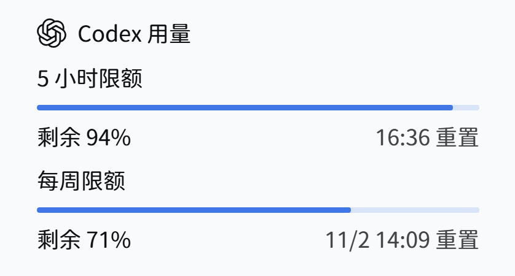

# Codex 额度显示

`dsh-codex-usage` 是一个 DSH 侧栏插件，用来查看 ChatGPT Codex 账户的 5 小时和每周额度。卡片背景透明，显示剩余比例和重置时间，并沿用 DSH 的字体与主题色。

<p align="left">
  
</p>

## 功能

- 显示账户当前可用的 5 小时和每周额度。
- 套餐没有 5 小时窗口时，只显示每周额度。接口失败或没有可识别的额度窗口时显示不可用状态，不估算额度。
- 设置页提供侧栏总开关。5 小时和每周额度是缩进的子开关；关闭总开关后，子开关会禁用，原选择会保留。
- 自动刷新间隔可设为 1、5、15 或 30 分钟，默认 1 分钟。显示选项和刷新间隔保存在当前浏览器中，不会跨浏览器同步。
- 关闭侧栏总开关会隐藏卡片并停止侧栏自动刷新。设置页仍可手动刷新。

## 安装指南

### DSH Web

在运行 Web profile 的主机上执行：

```sh
dsh plugin --profile web add dsh-codex-usage
```

### DSH Desktop

打开 Desktop 工作区，在侧栏进入“插件”，选择“添加插件”，输入 `dsh-codex-usage` 并安装，安装完成后选择“立即启用”。

## 登录

启用插件后，在 DSH 设置中打开“Codex 额度显示”，点击“登录”，再用系统浏览器完成 OpenAI 授权。若浏览器没有自动打开，可点击设置页中的登录链接；若本机回调没有完成，可粘贴浏览器跳转后的完整地址。等待授权时可以取消登录，也可以随时退出账户。

插件使用 DSH 凭据服务保存 `dsh-codex-usage/openai-codex` 账户凭据。令牌刷新由凭据服务串行写入；访问令牌留在 Host，不会传给侧栏 Client。使用本插件不需要 Codex CLI。

## 额度数据与配置

Host 使用 `@earendil-works/pi-ai` 的 OpenAI Codex OAuth 提供器，向 `https://chatgpt.com/backend-api/wham/usage` 请求额度。这个接口不是公开稳定 API，字段和套餐支持可能变化；部分套餐或组织账户不会返回 5 小时窗口。

用量成功结果默认缓存 60 秒，失败结果最多缓存 10 秒。Bundle 配置支持以下选项：

| 配置 | 默认值 | 允许范围 | 说明 |
| --- | ---: | ---: | --- |
| `timeoutMs` | `15000` | `1000` 至 `60000` 毫秒 | Host 请求超时 |
| `cacheMs` | `60000` | `0` 至 `600000` 毫秒 | 成功结果缓存时间；设为 `0` 可关闭成功缓存 |

## 运行要求与开发

- DSH `>=0.2.0-rc.1`
- Node.js `>=22.19.0`

安装项目依赖并运行测试：

```sh
npm ci
npm test
```

测试不需要 ChatGPT 账户。克隆源码或安装项目依赖不会自动把插件装入 DSH；插件安装和实际账户登录需要分别完成。侧栏卡片使用 `sidebar.footer.action` 插槽和 `:has()` 选择器占满一行，依赖当前 DSH 侧栏布局；如果插槽结构调整，可能需要更新样式。

## 许可与标志

插件采用 MIT 许可，见 [LICENSE](LICENSE)。OpenAI 和 Codex 名称及标志属于各自权利人。
