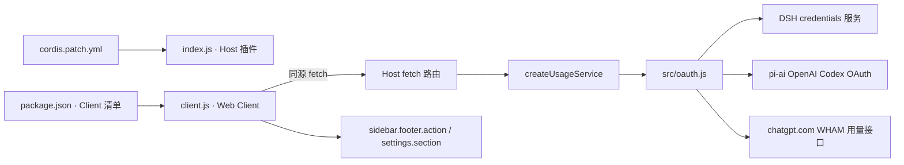

# 开发指南

本文描述 `dsh-codex-usage` 当前源码的结构、运行方式和维护约定。设计取舍见下方的[决策索引](#决策索引)；具体理由和影响记录在 `docs/decisions/`。

## 本地开发

- 运行环境：Node.js `>=22.19.0`。项目依赖 `@earendil-works/pi-ai@1.4.0`，其 `engines.node` 要求此版本。
- 安装锁定依赖：`npm ci`
- 运行自动化测试：`npm test`（脚本为 `node --test`）
- `package.json` 当前没有 build、lint 或格式化脚本。测试无需真实 ChatGPT 账户；但通过测试不代表已验证实际 DSH 插槽、浏览器 OAuth 或 OpenAI 用量接口。

项目使用原生 JavaScript ES modules，不使用构建步骤。修改依赖时同时审查 `package.json` 与 `package-lock.json`，不要只改其中一个。

## 架构与数据流

Host 是凭据和网络请求的唯一所有者。Client 通过 DSH 提供的同源 fetch 路由读取净化后的用量和登录状态，再向侧栏及设置插槽注册组件。

### 文件地图

| 路径 | 职责 |
| --- | --- |
| `index.js` | Host 插件入口；读取配置，创建 OAuth 与用量服务，注册 `/api/dsh-codex-usage` 路由，并在 effect 清理时注销路由、取消登录及中止请求。 |
| `client.js` | Web Client 入口；注册中英文字符串、设置页和侧栏卡片，处理刷新周期、显示开关、登录交互、重试与渲染。 |
| `src/oauth.js` | 把 DSH credentials 服务适配为 pi-ai 凭据存储；执行浏览器 OAuth、读取有限账户资料、调用 WHAM 接口及规范化两个用量窗口。 |
| `src/shared.js` | 定义安全的用量结果 DTO，并将状态限制为 OAuth/WHAM 路径支持的状态。 |
| `locale/zh.json`, `locale/en.json` | 插件元数据使用的中英文资源。Client 界面的即时词条也在 `client.js` 的 `dictionaries` 中维护；修改界面文案时检查两处是否需要同步。 |
| `cordis.patch.yml` | bundle patch：插入插件并提供 Host 配置默认值。 |
| `test/*.test.js` | Node 内置测试；覆盖 Client 插槽、路由、OAuth、缓存及 WHAM 数据规范化。 |

### Host 配置与 API

`cordis.patch.yml` 默认设置：

- `timeoutMs`: 默认 `15000` 毫秒，Host 会限制到 `1000–60000` 毫秒。
- `cacheMs`: 默认 `60000` 毫秒，限制到 `0–600000` 毫秒；`0` 表示关闭成功结果缓存。失败结果最多缓存 `10000` 毫秒，并且不超过 `cacheMs`。

Host 注册两个同源路由：

- `GET /api/dsh-codex-usage` 返回 `{ status, windows, checkedAt, expiresAt }`；加 `?refresh=1` 会跳过有效缓存。窗口字段为 `fiveHour` 和 `weekly`，每个值是 `{ usedPercent, resetsAt }` 或 `null`。
- `/api/dsh-codex-usage/auth` 支持 `GET` 查询登录阶段和允许显示的账户资料；`POST` 的 `action` 为 `start`、`submit`、`cancel` 或 `logout`。响应设为 `no-store`。登录输入有长度限制。

Client 不持有 OAuth access/refresh token。侧栏把服务返回的 `usedPercent` 转换为剩余比例 `100 - usedPercent`。成功响应含可识别的每周窗口但缺少 5 小时窗口时，5 小时行视为当前套餐未提供而隐藏；其他未知窗口仍显示不可用。不要用估算值补齐。

### Client 行为与 DSH 插槽

- `package.json` 的 `dsh.client` 声明 Web 平台、立即加载，并注入 sidebar 与 locale Client 模块依赖。
- DSH 的 ClientModuleRegistry 使用 bundle Loader entry 的 `name` 解析 Client 包，并要求最近的 `package.json.name` 与该名称相同，否则会跳过该 Client 模块。项目正式包名固定为 `dsh-codex-usage`；本地安装使用 `dsh-codex-usage@file:<本地目录>`，不要把包目录改写成 `@local/dsh-codex-usage`。`package.json.name`、`cordis.patch.yml` entry 的 `name`、`client.js` 注册的模块 `id` 必须一致；`exports['./client']` 还需指向 Client 入口。
- `package.json.dsh.client.inject` 声明 Client 模块图依赖；`client.js` 返回对象中的 `inject` 则声明 Cordis Service 依赖，两者是不同层级。当前 Client 分别依赖 sidebar/locale 模块和 `slots`/`locale` Service。
- Client 等待 `sidebar.footer.action` 和 `settings.section` 这两个实际子插槽出现后再注册。不要只等待父级 `sidebar` 或 `sidebar.settings`：父级可能先于子级声明。
- 侧栏卡片注册顺序为 `-1000`，设置页为 `35`。卡片通过局部 CSS 适配整行宽度，并使用 DSH 字体和主题 token。
- 卡片挂载时读取一次；侧栏挂载且总开关开启期间，按浏览器本地设置的间隔自动刷新。关闭总开关会隐藏卡片并停止侧栏轮询。设置页提供侧栏总开关及其 5 小时/每周窗口子开关；子开关缩进显示，并在总开关关闭时禁用且保留已保存的选择；设置页也提供手动刷新。可选刷新间隔为 1、5、15、30 分钟，默认 1 分钟；间隔和三个显示开关默认均开启，并保存在当前浏览器的 `localStorage`。
- OAuth 页面由用户点击登录时预先打开空白页，之后再导航到授权地址，以降低弹窗拦截概率。若自动回调无法完成，可提交浏览器重定向后的完整 URL。

## 维护约定与已知限制

- 保持凭据、刷新令牌及上游响应留在 Host。新增 Client API 字段时采用明确白名单，避免透传认证对象或原始响应。
- 保留 `ctx.effect()` 的清理函数：路由注销、共享请求中止、登录取消和 Client 请求/计时器清理都是生命周期的一部分。
- WHAM 接口是非公开稳定 API，服务端结构、套餐支持和可用窗口可能改变。解析应依据窗口时长，容忍缺失字段；失败时返回不可用状态，不伪造限额。
- 侧栏占满宽度依赖 `client.js` 的 `:has()` CSS 选择器和 DSH 当前插槽包装结构。若 DSH 改动 DOM 层级或插槽布局，需在实际侧栏复核样式。
- `src/oauth.js` 使用 `AbortSignal.any()` 与 `AbortSignal.timeout()`；保持 Node 最低版本要求，除非替换这些运行时 API 并重新核实依赖的版本范围。

## 验证建议

1. 运行 `npm test`，确认数据规范化、缓存、取消、OAuth 路由和 Client 插槽测试通过。
2. 若改动 Client 集成或 CSS，在 DSH Web UI 中确认侧栏与设置页实际插入、宽窄状态、主题适配及组件卸载后的计时器清理。
3. 若改动 OAuth 或额度接口，使用可取消的 Host 请求验证未登录、错误、超时和退出登录路径；不要把令牌写入日志或测试快照。
4. 若改动配置或 bundle 元数据，检查 `cordis.patch.yml`、`package.json` 和包文件清单彼此一致。

### 插件元数据与 Client 包身份

[package.json](../package.json) 声明顶层 `"icon": "./icon.svg"`、`exports` 中的 `"./package.json": "./package.json"`，并保留 `./icon` 导出。DSH 可通过导出的包清单读取顶层图标路径；缺少该导出或图标声明时才回退到 `./icon`。

ClientModuleRegistry 使用 `cordis.patch.yml` 中的 Loader entry 名称定位包，并要求包清单的 `name` 与它一致。本插件的 canonical 身份固定为 `dsh-codex-usage`；保持 manifest name、Loader entry name 与 Client factory id 相同，避免 Client 模块被跳过，导致侧栏和设置页都不注册。`dsh.client.inject` 声明模块图依赖；插件返回对象中的 `inject` 声明 Cordis Service 依赖。

ClientModuleRegistry 按 `baseURL + loaderName` 缓存包元数据，也缓存 `null` 解析失败结果。如果 canonical key 已经发生过 miss，在运行中的 Host 里重装同名包仍可能命中负缓存；完整重启 Host 会清除此缓存。从旧 alias 切换到此前未查询过的 `dsh-codex-usage` key 时，可在当前 Host 验证解析与插槽注册。

[package-metadata.test.js](../test/package-metadata.test.js) 在临时 profile 的 `node_modules/dsh-codex-usage` canonical 布局中验证包导出可解析、Loader entry 与 Client factory 身份一致、顶层图标及 `./icon` 导出指向同一文件且字节一致。安装验收应检查 Client 模块进入运行时图，并用真实 Client Slots inspect 检查目标插槽与注册项；不能以 `active`、安装成功或 Host 图标可见代替。图标应通过本机 DSH 的真实 `readPluginMeta('dsh-codex-usage', parentURL)` 验证 `error` 缺失且 SVG data URI 字节一致。若 canonical key 已被负缓存，完整重启 DSH 后复核。

## 决策索引

| 编号 | 决策 | 状态 | 记录 |
| --- | --- | --- | --- |
| 01 | 由 Host 管理 ChatGPT OAuth 与用量读取 | 已采纳 | [01-host-managed-oauth.md](decisions/01-host-managed-oauth.md) |
| 02 | 将 OAuth 凭据限制在 Host 边界内 | 已采纳 | [02-host-credential-boundary.md](decisions/02-host-credential-boundary.md) |
| 03 | 使用 WHAM 接口并按窗口时长识别额度 | 已采纳 | [03-wham-window-mapping.md](decisions/03-wham-window-mapping.md) |
| 04 | 在 Host 合并并缓存用量请求 | 已采纳 | [04-usage-cache-and-cancellation.md](decisions/04-usage-cache-and-cancellation.md) |
| 05 | 在实际声明的 Client 子插槽注册 UI | 已采纳 | [05-client-slot-integration.md](decisions/05-client-slot-integration.md) |
| 06 | 本地配置刷新周期并保留最后成功数据 | 已采纳 | [06-client-refresh-behavior.md](decisions/06-client-refresh-behavior.md) |
